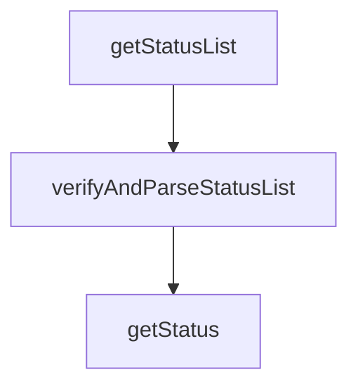

# Credential Status

This flow is used to obtain the credential status from its credential issuer. The following methods are currently supported:
- Token Status List (v1.4.6)

Each step in the flow is imported from the related file which is named with a sequential number.

#### Status list
The status list is a byte array embedded in a JWT/CWT, where a sequence of bits is used to represent the status of a digital credential. Each credential references the status list it is part of and the index to access its status. The following is an example for a SD-JWT credential:
```json
{
  "status": {
    "status_list": {
      "idx": 1000,
      "uri": "https://status-list.issuer.example"
    }
  }
}
```

## Sequence Diagram



## Example

<details>
  <summary>Credential status list flow</summary>

```ts
import { IoWallet } from "@pagopa/io-react-native-wallet";

const wallet = new IoWallet({ version: "1.4.6" });

const credentialIssuerUrl = "https://issuer.example.com";

const { issuerConf } = await wallet.CredentialIssuance.evaluateIssuerTrust(credentialIssuerUrl);

// Get the status list token and credential reference index
const { statusList: statusListJwt, idx } =
  await wallet.CredentialStatus.statusList.get(credential, format);

// Verify and parse the status list token
const statusList = await wallet.CredentialStatus.statusList.verifyAndParse(
  issuerConf.keys,
  statusListJwt,
);

// Read the credential status from the decoded status list
const { status, rawStatus } = wallet.CredentialStatus.statusList.getStatus(statusList, idx);

return {
  statusList,
  status,
  rawStatus,
};
```

</details>
